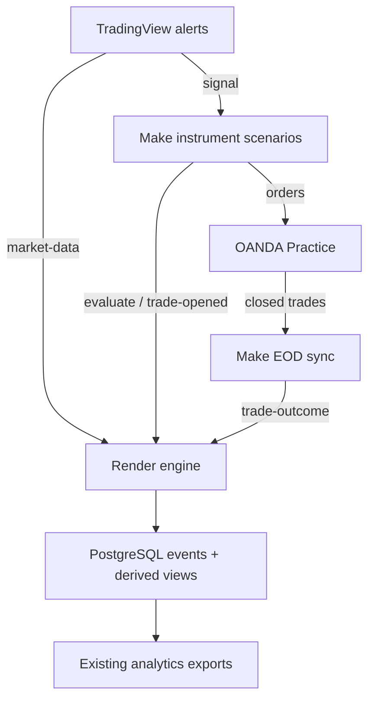

# ST LUDAETUC CLOUD V1.0 — TRADING DATA INTEGRITY & STRATEGY RESEARCH FOUNDATION

**DRAFT — NOT APPROVED. Isolated offline candidate. No production changes.**

## A. Executive summary

All **18 observed internal outcomes for 13 October** link through the derived Master Trading Log to their opening records and original predictions. This is stronger evidence than joining the export's trade_id columns directly: those columns use different namespaces. It does **not** prove complete OANDA account coverage.

The main research blocker is candle-time lineage. The bounded export contains **21,144 OHLCV records across 35 instrument/timeframe streams** for the complete UTC day. Every exported event_time is off its timeframe grid, with seconds and microseconds resembling server receipt time. Source code falls back to now() when payload.time is missing or invalid. That is a plausible explanation, **inferred**, not proof of the precise alert defect without original payload.time and received_at.

Implemented offline components retain evidence variants, reconstruct scoped lifecycle graphs, measure candle quality, replay conservative hypothetical outcomes, enforce bounded read access and demonstrate an offline Trade Explorer. No authoritative Finance arithmetic, live strategy changes or production integration were introduced.

## B. Data integrity verdict

**Blocked on evidence for a complete, trustworthy research dataset.** Data exists and is queryable, but original bar timestamps, broker population, retry versions, raw feature availability and financial completeness remain unproved. No claim of profitability, full reconciliation or production readiness is made.

### Architecture and source inventory

| Flow | Identifiers, timing and persistence | Verification limits |
|---|---|---|
| TradingView → market-data → events | Ticker/interval normalised; event hash includes parsed time; raw payload stored; missing/invalid time falls back to server now | Source and exported rows inspected; live alert schema, enabled inventory and original bar times unavailable |
| TradingView → Make → evaluate → prediction | Pine meta.signal_id; raw signal, scores, account snapshot, plans and versions stored; event time from market.bar_time_utc | Prediction logging is non-fatal: evaluate 200 can occur without a persisted prediction |
| Make → OANDA → trade-opened | Internal trade_id is signal ID; response tradeOpened.tradeID supplies broker bridge; full response and snapshot decoded and stored | Internal status observed; Make sequencing/retries and broker completeness unverified |
| OANDA → Make EOD → trade-outcome | Broker trade ID used by closure/view; fixed hash per trade ID; optional P&L/R fields; extra fields allowed | Partial closes, complete account history, currency and costs unproved |
| Events → views → analytics | Outcome broker ID → opening payload broker ID → prediction signal ID; LEFT JOIN preserves orphan outcomes | No account key in joins; cross-account collisions and fanout not constrained |

The source events table contains event_id, event_type, origin, destination, trade_id, instrument, timeframe, event_time, received_at, schema/strategy/model versions, environment, status, retry_count, experiment/deployment references and JSONB payload. It has type/time, instrument/timeframe/time, trade ID and opening broker-ID indexes. Free-text event fields are not fully bound to reference registries. The default environment is production; that does not establish OANDA live money.

The closed-outcome-centric master_trading_log is derived, not an independent ledger or complete open-position universe. master_decision_log retains decisions and downstream joins. The old Sheets lookup was replaced by this three-way bridge.

At the read-only query time, events_overview reported: 162,942 market_data, 701 prediction, 265 trade_opened and 220 trade_outcome rows. These are current rows after upserts, not total delivery counts. Earliest market_data was 1 October 00:30 UTC; latest was 14 October 22:28:18 UTC. Earlier candle history remains unproved.

Render metadata identifies live deploy dep-db2b0n0473hc739cejd0 at main SHA `2ca3fa49f1b6e44be55c5ccdc1dbddc44d9f5b3c`; health reports engine 3.11.0. Direct PostgreSQL querying remained unavailable under the internal-only boundary. No network access was weakened, and no engine startup code was executed.

The current System State Snapshot was read for governance context. Its approval note limits approval to the specification baseline, without activation, Effective Authority, gates or live money. It also contains inconsistent draft wording. No new approval or implemented state was inferred from it; actual source and bounded database-derived responses govern the findings here.

## C. Trade linkage verdict and 13 October audit

Sources: existing read-only engine endpoints, queried on 14 October around 22:28–22:29 UTC. Target event window: **[13 October 00:00, 14 October 00:00 UTC)**. Export cap: 15,000 rows per section; errors were empty and caps were not reached.

| Measure | Observed internal evidence | Meaning |
|---|---:|---|
| Predictions | 68 | 25 approved, 43 rejected |
| Order/open records | 25 | 18 FILLED, 7 CANCELLED |
| Outcome records | 18 | 10 win, 8 loss; realised R null for all 18 |
| Target-day bridge rows | 18 | 18 distinct broker trade IDs and signal IDs |
| Opening/prediction timestamps populated | 18 | All observed outcomes have both links |
| Bridge signals found in target-day FILLED export | 18 | 100% linkage of this observed internal cohort only |
| Authoritative OANDA closed population | UNKNOWN | No complete account export/cursor evidence |
| Official gross/net P&L and profit factor | UNAVAILABLE | No verified Finance inputs, currency or cost completeness |

The older 112 FILLED/43 CANCELLED observation remains a historical bounded cohort. It is not a current total. The preceding event window, 6 October 00:00–13 October 00:00 UTC, returned 336 predictions, 151 opens and 111 outcomes, with no section errors and cap 2,000 not reached.

The current 100-row bridged_trades section contains all 18 target-day outcome IDs, each linked to one of that day's 18 FILLED signals. No unlinked target-day outcome was observed in that section. Unlogged broker trades, current positions and partial-close histories cannot be enumerated from it. The authoritative list of missing trades is **unknown**, not empty.

Eighteen trade-outcome HTTP 200 receipts arrived at 23:30:06.149989850–23:30:07.526676104 UTC on 13 October; the bounded log query returned hasMore=false. This is consistent with 00:30 London on Wednesday 14 October. Matching counts do not prove a one-to-one mapping between calls and distinct closure transactions: logs omit payload IDs and the export omits retry_count.

The revised schedule is CEO-reported intent, not inspected Make configuration. The active scenario, timezone, pagination, retry rules, empty runs and catch-up watermarks remain unknown. Historical errors and late batches from the previous evidence audit must not be treated as proof that the revised configuration is currently failing.

## D. Market-data verdict

**Not yet adequate for defensible temporal replay.** Target-day exported counts:

| Instrument | 1m | 2m | 3m | 5m | 10m |
|---|---:|---:|---:|---:|---:|
| GBPUSD | 1434 | 718 | 479 | 288 | 144 |
| EURUSD | 1427 | 718 | 479 | 288 | 144 |
| AUDUSD | 1407 | 714 | 477 | 288 | 144 |
| USDCAD | 1434 | 718 | 479 | 288 | 144 |
| USDJPY | 1430 | 717 | 479 | 288 | 144 |
| XAUUSD | 1376 | 688 | 459 | 276 | 138 |
| XAGUSD | 1376 | 688 | 459 | 276 | 138 |

These are observed streams, not a verified alert inventory. Exact first/last timestamps and interval-gap candidates are in day_candle_audit.json. Every timestamp is off-grid. No duplicate exact timestamps, conflicting OHLC records or invalid/nonpositive OHLC were detected in this bounded export. The endpoint sorts by event_time, so its row order cannot establish actual delivery order.

Receipt times, original bar open/close times, provider, confirmation status and indicators are omitted. Therefore latency, actual missing bars and indicator completeness cannot be established. The nominal 1,440-minute grid is not a verified trading-session calendar. Metals each have only one record in the 21 UTC hour and 55 in the 22 UTC hour; a market break is plausible but unverified. FX reductions, especially AUDUSD during 20–23 UTC, need source/session evidence. Nominal deficits and receipt-like intervals are **not missing-bar facts**.

Completeness pass criteria: verified provider/ticker/timeframe roster and session calendar; original bar times; expected unique slots including boundaries; explicit confirmed status and warm-up; no unresolved invalid/conflicting rows; complete pagination; receipt/arrival evidence; and a same-provider bid/ask/mid sample comparison. Original bar-time and calendar evidence currently fail or remain unproved. Independent price comparison was not feasible with a grounded provider dataset; no credentials were requested.

The old placeholder 422 problem is not declared currently active. Supplied status remains **RESOLVED_PENDING_FULL_COVERAGE_VERIFICATION**. Timestamp lineage is a separate finding.

## E. Research readiness and preservation findings

Reliable profit-factor and rejected-opportunity research cannot yet begin on the production exports alone.

Source log_event() uses ON CONFLICT(event_id) DO UPDATE: payload and status are replaced, received_at changes and retry_count increments. Previous event_time/indexed metadata remain, potentially contradicting the replacement payload. Exact retries and legitimate corrections are not distinguished. A single outcome ID per broker trade can collapse multiple partial-close versions. Overwritten original facts cannot be recovered without an external archive.

Malformed account/order JSON is retained only as a truncated _unparsed value, with log previews. A secure raw-body archive and redacted error handling need review. The opening decoder derives one tradeOpened ID but does not derive all tradeReduced/tradesClosed effects. A FILLED order with no newly opened trade can legitimately reduce or close an existing position.

Other findings:

- TradeOutcome's docstring still describes signal IDs, while the view uses broker IDs.
- Exact-text instrument filtering splits GBPUSD predictions/candles from GBP_USD opening/outcome records. Per-instrument exports returned zero order rows although the aggregate export returned 25.
- No authentication or hard server-side maximum row/date limits were found on analytics endpoints. Requests without credentials returned trading data. No unbounded requests were attempted. Read-only is not equivalent to safe public access.
- prediction-accuracy includes the decision-bar range and assumes entry was filled. Same-bar TP/SL is labelled loss rather than preserved as ambiguous.
- Its COALESCE of final/hypothetical JSONB plans does not strip JSON null, which can shadow a valid hypothetical plan. This is a source-level defect risk, not reproduced PostgreSQL runtime evidence. The proposed read-only query uses NULLIF; existing code was not changed.

## F. Engineering changes and implementation limits

Branch `research/trading-data-foundation-v1` was created from verified main, not Finance. Local work is isolated in research_workspace. This workspace has no git worktrees; GitHub operations use a verified base tree and a branch lease.

Implemented under research/trading_data:

- evidence.py: retained immutable variants, receipt history, conflicts and reviewed same-scope correction lineage.
- lifecycle.py: account/environment-scoped prediction, order, fill, trade and outcome reconstruction; partial/multiple fills, orphan records, duplicate/conflicting evidence and cancellation denominators.
- candles.py: quality audit with explicit calendar inputs; absent evidence does not become zero.
- replay.py: hypothetical R-only replay with entry prerequisites, cost assumptions, lookahead guards and explicit ambiguity.
- explorer.py and explorer.html: bounded reader reference and synthetic offline viewer.
- retention_candidate.sql: append-only research storage proposal; not applied.
- operator_readonly_queries.sql: bounded parameterised acquisition proposals; not executed.
- field_mapping.csv: all 637 legacy headers, with provisional mappings labelled.
- daily_report.schema.json and example: bounded reporting contract without competing Finance arithmetic.
- tests and redacted evidence summaries.

The normalised graph is a reference substrate, not a commissioned broker adapter. Full transaction profiles, raw legacy adaptation, snapshots, balance roll-forward, automatic EOD integration and durable production writers remain proposed. Financial results are delegated to the frozen Finance contracts. SQL is grammar-tested only. No production imports, startup hooks, credentials, network service or trading calls were added.

## G. Historical field mapping and provenance

The old Master Trading Log has 637 header columns and 2,505 grid rows; metadata last modified 2 October 23:19 UTC. Only headers were read. A header does not prove populated historical values.

The complete CSV maps each old header to a current candidate field, source, type, availability, validation and research use. Signal identity maps to prediction; execution details to raw order responses; outcomes to optional closure fields; indicators to raw signal payloads where supplied. Automatically derived paths are labelled **candidate, not verified**. Pipeline, position, learning and review fields often have no demonstrated equivalent. Narrow views/exports do not prove the underlying payload fields were lost.

Main-branch GBPUSD and XAUUSD Pine mirrors were inspected, without claiming equality to live alerts. ADX/DI, RSI, MACD, EMAs, Bollinger width, VWAP and distance features already appear in the GBP payload. These should be audited or ablated, not proposed under new names.

Each feature needs source schema/hash, parameters, source bar close and available_at. Rebuilt indicators require valid candles, warm-up and feed/timeframe definitions and must remain separate from original decision inputs. MFE/MAE and alternative exits need post-entry data; actual stop movements and manual actions require broker transactions and cannot be recovered from OHLC alone.

## H. Rejected-signal methodology and research programme

The 43 observed rejections comprise 18 SIGNAL_SCORE_TOO_LOW, one CONTEXT_SCORE_TOO_LOW, 22 INSUFFICIENT_POST_GATE_EDGE and two SPREAD_TOO_WIDE. Original plans/raw indicators are stored by code but omitted from the export. No production rejected cohort was replayed, and no rejection was called a mistake.

Replay protocol: freeze the original decision, plan, direction, order semantics, prerequisites and available features; verify subsequent data; model fill before exit; supply realistic costs; exclude incomplete warm-up/gaps; retain same-bar and entry/exit ambiguity. Separate policy-compliant rejection from hypothetical profitability. Never consume future decision-bar highs/lows as entry-time information.

Diagnostics should consume reviewed Finance economic inputs and retain sample sizes and missingness. Segment profit factor, expectancy, win/loss distributions, R, duration, drawdown, streaks, MFE/MAE, calibration and cost sensitivity by instrument, timeframe, session, weekday, model, setup, version and regime only when inputs support them. Cancelled orders are not executed-trade denominators. Eighteen outcomes are a small descriptive cohort; realised R is entirely absent and official profit factor is unavailable.

Ranked research backlog:

1. Audit existing EMA/ATR distances and spread regimes before adding features.
2. Test volatility percentiles, trend persistence and momentum acceleration on validated candles.
3. Test session transitions and confirmed higher-timeframe structure.
4. Ablate existing ADX/DI/Bollinger width features using actual historical values.
5. Consider Keltner compression after checking equivalent existing definitions.
6. Use relative volume/VWAP only with defensible feed-specific activity data; FX tick activity is not exchange volume.

All require time/coverage repair first. No improvement in profitability is asserted.

Experiment design remains proposed: frozen Champion SHA and input manifests; immutable feature definitions; time-ordered train/validation/final holdout; walk-forward tests; purge/embargo covering overlapping labels; preregistered hypotheses/costs; multiple-testing controls; clustered uncertainty by day/instrument; predeclared sample and regime requirements; and out-of-sample stability under cost perturbations. Never optimise the final holdout or promote a Challenger solely on better historical profit factor.

## I. Explorer, daily report, tests and blockers

The offline Explorer uses synthetic records only, with filter/search/details and no network calls. Reader helpers require an explicit trusted Principal, account scope, permission, a maximum 31-day window and 500 rows, plus an audit sink. This is not JWT authentication. A future gateway must validate issuer, audience, expiry and scopes; never trust a client-supplied authenticated flag. It needs a separately reviewed read-only role, cursor, redaction and access audit.

The first daily report example targets 13 October UTC and includes observed decisions/order/outcome counts, 18/18 internal linkage, unproved broker/candle coverage, the receipt burst, unavailable Finance inputs and blocked replay/profit factor. No scheduled automation or messages were created. Future reports must carry event window, receipt window, last complete broker watermark and source retrieval time separately.

**48 tests executed: zero failures, errors or skips.** They cover synthetic Python behaviour, contract validation and SQL grammar. No database runtime, production integration or browser visual QA is claimed. The local PostgreSQL environment remains blocked by UID-0-only execution; no root bypass or shared database substitute was used. Test IDs/results are in evidence/test_results.json.

Priority evidence requests:

1. Approved read-only extracts of original candle time/time_close, event_time and received_at from all 35 streams.
2. Complete redacted OANDA Practice transactions and current position snapshot, with account mapping, currency, pagination and range manifest.
3. Bounded raw prediction/open/outcome records with original event IDs, broker links, account aliases, versions, retry_count and plans.
4. Actual TradingView alert inventory: provider, symbol, timeframe, script/version, condition and enabled state.
5. Current Make EOD blueprint, scheduler timezone, retries, pagination, cursor and run/output identities.

No credentials are requested. Approved operators can supply redacted evidence. Proposed queries must use an approved read-only identity and remain bounded.

Remaining engineering: transactional append-only writer and conflict quarantine; complete legacy/broker adapters; validated bar-time/session contract; full population reconciliation; raw-feature availability audit; Finance input interface; authenticated Explorer/export cursor; SQL runtime/privilege proof; and same-feed comparison with frozen replay inputs. Cross-workstream integration is deferred until reviewed.

CEO decisions genuinely required concern future production/security/access/deployment changes and research promotion policy. Evidence acquisition and technical review should precede those decisions. Routine offline work required no intermediate approval.

## J. Independent review handover and status matrix

| Deliverable | Status |
|---|---|
| Architecture, source inventory and preservation findings | Documented; source verified |
| Target-day internal audit and linkage | Read-only observed; broker universe unproved |
| Candle completeness report | Audit executed; original times and sessions blocked |
| Lifecycle, evidence journal, replay and reader references | Implemented; synthetic tested; not independently reviewed |
| 637-column mapping | Headers verified; historical values unproved |
| Explorer prototype | Synthetic offline implementation; not deployed |
| Daily contract/example | Schema tested; authoritative Finance inputs unavailable |
| Diagnostics, feature backlog and experiment framework | Proposed; governance required before promotion |
| Retention SQL and production integration | Proposed; grammar tested only; runtime unproved |

Claude should review the exact frozen research SHA in the external handover, verify that changes are confined to research/trading_data and derive from main, run the 48 tests, repeat bounded evidence reads where authorised, and obtain broker/bar-time manifests before accepting completeness. Adversarial review should focus on correction lineage, population coverage, partial fills, lookahead, cost ambiguity and the future identity gate.

Finance SHA `832fc31e02a494d88af3676a4e3e685a3f5f7692`, PR #2, main, reviewer branches, Chief, governance and production systems were not modified. No draft research PR was created. Nothing was merged or deployed.

Primary technical references read: TradingView Pine concepts/alerts and concepts/time; OANDA transaction-df, trade-df and instrument-df. They support required source fields and multi-action/candle semantics, not account completeness. Technical links: https://www.tradingview.com/pine-script-docs/concepts/alerts/ ; https://www.tradingview.com/pine-script-docs/concepts/time/ ; https://developer.oanda.com/rest-live-v20/transaction-df/ ; https://developer.oanda.com/rest-live-v20/trade-df/ ; https://developer.oanda.com/rest-live-v20/instrument-df/ .

Full redacted source summaries and hashes are provided; raw financial/account exports are not published to GitHub.

TRADING_DATA_FOUNDATION_BLOCKED_ON_EVIDENCE
